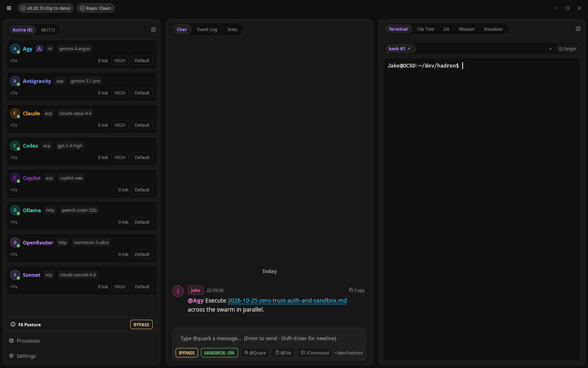

# 🌌 Hadron

<div align="center">

**The Native Desktop Workspace for Multi-Provider LLM Swarms**

*Orchestrate Frontier LLMs (Claude, Antigravity, OpenAI, Grok) and Local/OpenRouter Agents in Isolated Git Worktrees with Automated Merge Gating*

[](LICENSE)
[](https://www.rust-lang.org/)
[](https://zed.dev)
[](https://agentclientprotocol.com)
[](docs/architecture/decoupled-architecture.md)

  <br />

  

</div>

---

## ⚡ What is Hadron?

**Hadron** is a native, GPU-accelerated desktop workspace built in Rust for **orchestrated multi-provider LLM swarms**. It brings frontier models (**Anthropic Claude**, **Google Antigravity**, **OpenAI**, **xAI Grok**) together with **OpenRouter**, local **Ollama / vLLM**, and any custom **ACP or coding CLI agent** in a unified room where agents collaborate, exchange context, and delegate tasks using `@mentions`.

Behind the interface, agents (called **Quarks**) execute concurrently over a zero-CPU filesystem event bus (`field.jsonl`), work safely in isolated git worktrees, and submit code changes through an automated **Merge Gate** that runs tests before landing anything on `main`.

---

## 💡 Key Superpowers

- 💬 **Universal Multi-Model Swarms**: Mix frontier models (`@claude`, `@agy`, `@openai`, `@grok`), OpenRouter, local `@ollama`, and custom CLI agents in one thread via Hub-and-Spoke `@mention` orchestration over a zero-CPU `field.jsonl` bus.
- 🛡️ **Collision-Proof Worktrees & Merge Gate**: Quarks work in isolated git worktree branches. The automated **Merge Gate** rebases onto `main` and runs your real test suite before clean code lands — with **Hadron Lab** concurrent merge gates, speculative batch evaluation, and docs/asset fast-paths.
- 💰 **Token-Efficient Swarm Economics**: Cuts multi-agent input token spend by **80–90%** via resident prompt caching (`cache_read`), Hub-and-Spoke context isolation (preventing $O(N^2)$ sibling log broadcasts), `ContextGovernor` output elision, lazy pointer-based Nucleus memory, and live 4-way USD/quota telemetry.
- 🔒 **Cross-Platform Process Sandboxing**: Zero-overhead native OS containment across Linux/WSL (Bubblewrap), macOS (Apple Seatbelt), and Windows (PowerShell & Job Objects) with worktree write confinement, credential scrubbing, and interactive chat badge toggles.
- 🛠️ **AST Edit-by-Hash (`blake3`) & 50+ MCP Forge Tools**: Eliminates LLM line-drift corruption via content-addressed AST precision edits, plus isolated PTY terminals, headless browser testing, LSP code intelligence, automated `git bisect`, and flamegraph profiling ([`Power Tools Suite`](docs/forge/power-tools.md)).
- ⚡ **120 FPS GPUI Desktop, Headless CI & `/absorb` Memory**: Native Rust workspace with interactive File Tree CRUD, multi-tab PTY terminals, Git & Wave DAG visualizers, standalone `hadron run` / `hadron ci` runners, 29 bundled engineering skills, and `/absorb` to import rules from `.claude/`, `.cursor/`, `.windsurf/`, and `.agents/`.

---

## 🚀 Quick Start

### Prerequisites

- **OS**: Linux (X11/Wayland), macOS, or Windows (native MSVC or WSL2).
- **LLM Access**: Any ACP agent (e.g. Claude Code), Antigravity, local Ollama, or API key for OpenAI / OpenRouter / Anthropic.

### 1. Install Hadron

#### Quick Install (Prebuilt Binaries — Recommended)

**Linux & macOS:**
```bash
curl -fsSL https://raw.githubusercontent.com/s0lda/hadron/main/install.sh | sh
```
*Detects Linux and macOS architectures, validates SHA256 checksums, and installs all three binaries (`hadron`, `hadron-gluon`, `hadron-forge-mcp`) into `~/.local/bin`.*

**Windows (PowerShell):**
```powershell
irm https://raw.githubusercontent.com/s0lda/hadron/main/install.ps1 | iex
```
*Installs Hadron to `$env:LOCALAPPDATA\Programs\Hadron`, verifies SHA256 checksums, configures user PATH, and sets up Start Menu / Desktop shortcuts with the custom Hadron application icon.*

#### Build from Source (Cargo)

*Requires Rust toolchain (Rust 1.93+, edition 2021).*

```bash
cargo install --locked --git https://github.com/s0lda/hadron.git hadron
```


### 2. Launch in Any Repo

```bash
# Open or create a swarm workspace in your project directory
cd ~/dev/my_project && hadron

# Or execute headlessly in CI / terminal batch mode
hadron run "Implement user authentication with tests"
hadron ci --plan .hadron/docs/plans/<plan_name>
```

---

## 📚 Documentation & Deep Dives

Explore Hadron's mechanics, architecture, and developer guides in the [`/docs`](docs/) directory:

| Section | Description | Links |
| :--- | :--- | :--- |
| 📜 **Changelog** | Release history & version notes | [`Changelog`](docs/CHANGELOG.md) |
| 🕹️ **Commands** | Full interactive chat commands reference | [`Commands Reference`](docs/commands.md) |
| 🏛️ **Architecture** | 2-Tier Daemon/GUI split & Swarm Event Loop | [`Decoupled Architecture`](docs/architecture/decoupled-architecture.md) · [`System Diagrams`](docs/architecture/system-diagrams.md) |
| ⚛️ **Concepts & Physics** | Particle Physics Mental Model & Glossary | [`Physics Metaphor`](docs/concepts/physics-metaphor.md) · [`Vocabulary`](docs/concepts/vocabulary.md) |
| 🛠️ **Hadron Forge** | AST Edit-by-Hash & Developer Power Tools | [`Edit-by-Hash Engine`](docs/forge/edit-by-hash.md) · [`Power Tools Suite`](docs/forge/power-tools.md) |
| 🌿 **Development** | Building from Source & Git Worktrees | [`Building from Source`](docs/development/building-from-source.md) · [`Git Worktrees`](docs/development/git-worktree-usage.md) |

---

## 🔌 Provider & Model Ecosystem

Hadron connects an expanding ecosystem of AI agents, local models, cloud APIs, and terminal tools into a single orchestrated workspace. Any binary, endpoint, or script matching supported protocol interfaces can be seated directly into your swarm:

- 🤖 **ACP (Agent Client Protocol)**: Resident agent processes with automatic session resumption, model selection, and tool execution.
- 🌉 **Custom SDK Bridges**: Embedded adapters for SDK-based agent runtimes (such as Google Antigravity).
- ☁️ **Local & Cloud HTTP Endpoints**: Zero-config connection to local model servers (Ollama, LM Studio) and cloud model aggregators or APIs (OpenAI, OpenRouter with 400+ models, or any OpenAI-compatible endpoint).
- 💻 **CLI & PTY Transports**: Stdio wrappers (`CliSpec`) for terminal scripts and interactive PTY terminal seats alongside LLM agents in the chat room.

---

## ⌨️ Essential Keyboard Shortcuts

| Shortcut | Action |
| :--- | :--- |
| `Ctrl+Tab` / `Ctrl+\` | Toggle focus between Chat Input and PTY Terminal |
| `Ctrl+Shift+T` / `Ctrl+Shift+W` | New / Close Terminal Tab |
| `Ctrl+PageDown` / `Ctrl+PageUp` | Next / Previous Terminal Tab (also `Ctrl+Shift+]` / `Ctrl+Shift+[`) |
| `Alt+Left` / `Alt+Right` | Switch Chat column tabs (`Chat` / `Log` / `Stats`) |
| `Alt+Shift+Left` / `Alt+Shift+Right` | Switch Quark Roster tabs (`Active` / `All`) |
| `Alt+PageUp` / `Alt+PageDown` | Switch Right-Rail Inspector tabs (`Terminal` / `Files` / `Changes` / `Plan` / `Visualizer`) |
| `Alt+Up` / `Alt+Down` | Cycle Telemetry & Stats time windows (`Session` / `Week` / `Month` / `All`) |
| `Ctrl+J` / `Ctrl+K` | Move selection in Quark Roster |
| `Ctrl+Alt+Enter` | Toggle selected Quark enabled / disabled |
| `Ctrl+O` / `Cmd+O` | Open Quick Project Switcher modal |
| `Ctrl+M` / `F10` | Open App Menu overlay |
| `F6` | Cycle global permission mode (`Ask` / `Write` / `Auto` / `Bypass`) |

---

## 📄 License & Community

- **License**: [Apache License 2.0](LICENSE)
- **Contributing**: [CONTRIBUTING.md](.github/CONTRIBUTING.md)
- **Security**: [SECURITY.md](.github/SECURITY.md)
- **Code of Conduct**: [CODE_OF_CONDUCT.md](.github/CODE_OF_CONDUCT.md)
- **Glossary**: [Physics Metaphor & Vocabulary](docs/concepts/vocabulary.md)
- **Commands**: [Chat Commands Reference](docs/commands.md)
